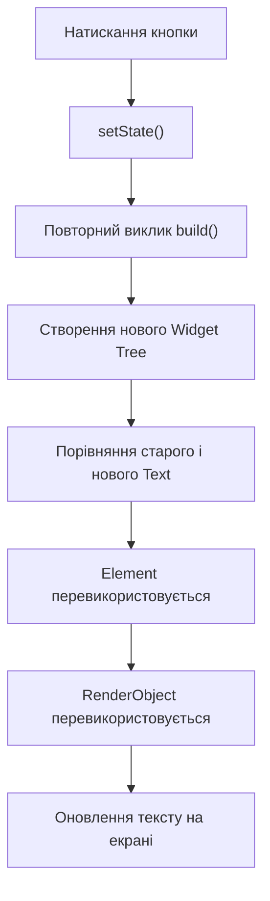
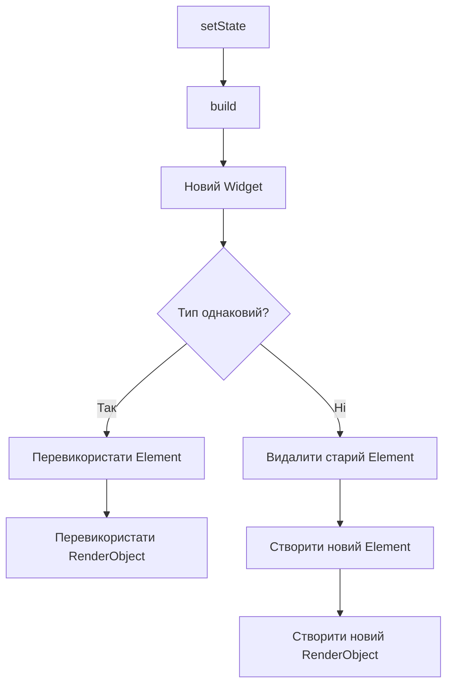

# Практична робота №2
## Дисципліна: Програмування для мобільних платформ
## Тема: Технологія Flutter
## Варіант 1: Три дерева Flutter


# Мета роботи
Дослідити принцип роботи трьох основних дерев Flutter (Widget Tree, Element Tree та RenderObject Tree), а також зрозуміти, як вони поводяться під час перебудови інтерфейсу після виклику setState()
# Теоретичні відомості
Flutter використовує три взаємопов'язані дерева:
### Widget Tree
Описує структуру інтерфейсу. Віджети є незмінними (immutable)
### Element Tree
Містить екземпляри елементів, які зв'язують віджети з реальним рендерингом
### RenderObject Tree
Відповідає за розрахунок розмірів, позиціонування та відображення елементів на екрані

# Приклад 1. Зміна тексту через setState()

При натисканні кнопки значення тексту змінюється з "Hello" на "Flutter".

Що відбувається після setState()
Flutter викликає метод build().
Створюється новий Widget Tree.
Flutter порівнює старі та нові віджети.
Оскільки тип віджета не змінився (Text залишився Text), існуючий Element перевикористовується.
RenderObject теж залишається тим самим.
Оновлюється лише текстовий вміст.



## Які вузли створюються заново

| Дерево | Поведінка |
|---------|---------|
| Widget Tree | Створюється заново |
| Element Tree | Перевикористовується |
| RenderObject Tree | Перевикористовується |

Під час виклику `setState()` Flutter створює нове дерево Widget, оскільки метод `build()` виконується повторно. Водночас Element Tree та RenderObject Tree не створюються заново, якщо тип віджета залишається тим самим. Flutter перевикористовує наявні Element та RenderObject, оновлюючи лише дані, що змінилися
# Приклад 2. Зміна типу віджета

Спочатку показується `Text`, після натискання кнопки відображається `Icon`.

```text
Text -> Icon
```

Тепер Flutter бачить, що тип віджета змінився.

Попередній Element більше не підходить для нового Widget.

У результаті:

- старий Element видаляється;
- створюється новий Element;
- створюється новий RenderObject.

## Діаграма 2. Зміна типу віджета



# Коли Flutter перевикористовує Element

Flutter перевикористовує Element, якщо:

старий та новий Widget мають однаковий тип;
мають однаковий ключ (`Key`), якщо він використовується

Наприклад:

```dart
Text("Hello")
```

↓

```dart
Text("Flutter")
```

Element залишається тим самим.

# Коли Element НЕ перевикористовується

Якщо тип змінюється:

```dart
Text("Hello")
```

↓

```dart
Icon(Icons.favorite)
```

Flutter створює новий Element та новий RenderObject

# Доказовість

Офіційна документація Flutter описує механізм оновлення дерева елементів та перевикористання елементів під час порівняння Widget Tree:

https://docs.flutter.dev/resources/inside-flutter

https://docs.flutter.dev/ui

# Висновок

Під час виконання роботи було досліджено взаємодію трьох дерев Flutter. Було встановлено, що під час виклику `setState()` віджети створюються заново, однак Element і RenderObject можуть перевикористовуватися. Це дозволяє Flutter мінімізувати кількість дорогих операцій рендерингу та забезпечувати високу продуктивність. Також було з'ясовано, що зміна типу віджета призводить до створення нового Element і нового RenderObject, оскільки попередня структура більше не може бути використана повторно
